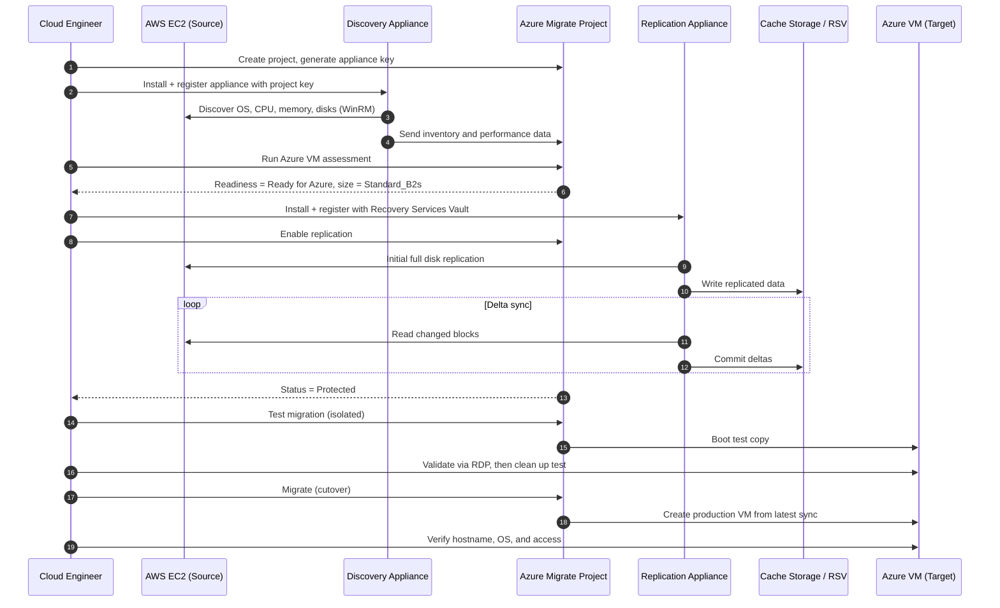

# AWS EC2 to Azure Migration with Azure Migrate


An end-to-end, cloud-to-cloud migration of a Windows Server 2022 workload from **AWS EC2** into **Azure** using **Azure Migrate**. Both environments are provisioned with **Terraform**, and the migration follows the full lifecycle used on real engagements: **discover → assess → replicate → test migrate → cut over → verify**.

**Walkthrough video:** _[Loom link]_

---

## Table of Contents

- [Business Context](#business-context)
- [What This Lab Demonstrates](#what-this-lab-demonstrates)
- [Architecture](#architecture)
- [Migration Flow](#migration-flow)
- [Key Concepts](#key-concepts)
- [Repository Structure](#repository-structure)
- [Prerequisites](#prerequisites)
- [Cost Estimate](#cost-estimate)
- [Deployment Guide](#deployment-guide)
  - [Part 1: Build the AWS Source Environment](#part-1-build-the-aws-source-environment)
  - [Part 2: Build the Azure Target Environment](#part-2-build-the-azure-target-environment)
  - [Part 3: Deploy and Register the Discovery Appliance](#part-3-deploy-and-register-the-discovery-appliance)
  - [Part 4: Assess the EC2 Instance](#part-4-assess-the-ec2-instance)
  - [Part 5: Deploy the Replication Appliance and Replicate](#part-5-deploy-the-replication-appliance-and-replicate)
  - [Part 6: Test Migration and Cutover](#part-6-test-migration-and-cutover)
- [Verification Checklist](#verification-checklist)
- [Troubleshooting](#troubleshooting)
- [Known Limitations](#known-limitations)
- [Teardown](#teardown)
- [Security Considerations](#security-considerations)
- [Lessons Learned](#lessons-learned)
- [What I Would Do Differently](#what-i-would-do-differently)
- [Skills Demonstrated](#skills-demonstrated)

---

## Business Context

### The problem

A company has just **acquired a business that runs on AWS**. Leadership has standardized on Microsoft Azure for licensing, identity (Entra ID), compliance tooling, and enterprise agreement pricing. Running two clouds in parallel means duplicate spend, two sets of security controls to audit, two skill sets to staff, and a fragmented operational picture.

The acquired company's Windows Server workloads need to move into the parent organization's Azure tenant with:

- **Minimal downtime** for the business units relying on those servers
- **No re-build** of the servers from scratch (lift-and-shift preserves configuration, data, and applications)
- **A validated, low-risk cutover** with a rollback path if the migrated server does not boot or behave correctly
- **Right-sized target VMs** so the company is not paying for over-provisioned compute after the move

### Why this matters

Cloud-to-cloud migration is one of the most common, highest-value engagements in cloud engineering. Organizations migrate for **cost consolidation, compliance alignment, M&A integration, or vendor strategy**. A failed or poorly planned cutover means outages, lost data, and broken trust with the business.

### The solution

This lab uses **Azure Migrate**, Microsoft's native migration hub, to run a controlled migration:

| Business need | How this lab addresses it |
|---|---|
| Know what you are moving | **Discovery** inventories the source server's OS, CPU, memory, and disks |
| Avoid surprises on migration day | **Assessment** checks Azure readiness and flags blockers before any data moves |
| Control cost in the target | **Performance-based sizing** recommends an Azure VM size from real utilization data |
| Minimize downtime | **Continuous replication** syncs disk changes in the background so cutover only needs the final delta |
| Reduce risk | **Test migration** boots a copy in Azure before committing to cutover |
| Repeatability and auditability | **Terraform** provisions both clouds as code so the environment can be rebuilt or reviewed |

---

## What This Lab Demonstrates

- Provisioning a source environment in **AWS** (VPC, subnet, IGW, route table, security group, IAM, EC2) with Terraform
- Provisioning a target and staging environment in **Azure** (resource groups, VNet, storage account, Log Analytics, Recovery Services Vault, NSGs, appliance VMs) with Terraform
- Creating an **Azure Migrate project** and registering a **discovery and assessment appliance**
- Running a **performance-based Azure VM assessment** and interpreting readiness results
- Deploying a **replication appliance** (built on Azure Site Recovery) and enabling replication
- Running a **test migration** in isolation, then performing the **production cutover**
- Diagnosing and resolving **Azure quota, SKU capacity, image generation, and platform-default errors** in Terraform deployments
- Selecting a **non-hyperthreaded VM size** to meet a physical-core requirement under a tight vCPU quota
- Using a **Terraform feature flag** to sequence resources around a regional vCPU limit
- Validating the migrated workload and **tearing down** both clouds cleanly

---

## Architecture

### High-level architecture


### Network design

| Environment | Network | Address space | Purpose |
|---|---|---|---|
| AWS | `vpc-migrate-<yourname>` | `10.0.0.0/16` | Source VPC |
| AWS | `snet-migrate-<yourname>` | `10.0.1.0/24` | Public subnet hosting the EC2 instance |
| Azure | `vnet-migrate-<yourname>` | `10.1.0.0/16` | Staging and landing network |
| Azure | `snet-migrate` | `10.1.1.0/24` | Appliances and the migrated VM |

> The Azure address space (`10.1.0.0/16`) is intentionally **non-overlapping** with the AWS VPC (`10.0.0.0/16`). If a site-to-site VPN or interconnect is added later, routing works without re-addressing either side.

### Resource group strategy

| Resource group | Contents | Lifecycle |
|---|---|---|
| `rg-migrate-source-<yourname>` | Migrate project, appliances, cache storage, vault, Log Analytics, VNet | Temporary migration tooling, destroyed after cutover |
| `rg-migrate-target-<yourname>` | Migrated VM, its NIC, disk, and NSG | Long-lived production workload |

Separating tooling from the workload means the migration infrastructure can be torn down without risk to the migrated server.

---

## Migration Flow

The sequence below shows the complete migration flow. Under a 10-vCPU regional quota, the discovery appliance is **deallocated** after assessment (step 6) and before the replication appliance is deployed (step 7).



---

## Key Concepts

### Discovery appliance vs. replication appliance

For VMware sources, Azure Migrate can replicate without a separate replication appliance. **For AWS, GCP, and physical servers, two appliances are always required:**

| Appliance | Role | Underlying technology |
|---|---|---|
| **Discovery and assessment appliance** | Inventories the source server and collects performance data used for sizing | Azure Migrate appliance (physical / other-cloud scenario) |
| **Replication appliance** | Performs block-level disk replication into Azure and orchestrates cutover | Azure Site Recovery (Configuration / Process server) |

> **Note on "agentless":** Discovery and assessment are agentless, since nothing is installed on the EC2 instance to inventory it. For the AWS/physical replication path, the replication appliance uses the Azure Site Recovery **Mobility service** on the source machine to capture disk changes. Agentless *replication* is only available for VMware and Hyper-V sources, so it is not an option for EC2. Understanding this distinction is a common interview topic.

### Physical cores vs. vCPUs

Most current Azure VM sizes use **simultaneous multithreading (SMT / hyperthreading)**, where 2 vCPUs share 1 physical core. An 8-vCPU size on an SMT family therefore provides only **4 physical cores**. This matters when software checks physical core count rather than logical processors, as the ASR replication appliance's prerequisite check does. Azure exposes this as the `vCPUsPerCore` capability in `az vm list-skus`.

Some families are **non-SMT** (`vCPUsPerCore = 1`), so every vCPU is a full physical core. The AMD **Fasv6 / Fasv7** sizes are an example: `Standard_F8as_v6` provides 8 physical cores while consuming only 8 vCPUs of quota. When filtering for non-SMT sizes, rule out two look-alikes:

| Size pattern | Why it does not work here |
|---|---|
| A `p` in the name (`D8ps_v6`, `B8pls_v2`, `E8ps_v6`) | **Arm64** processors. Windows Server images and the Azure Migrate appliances require x64 |
| `F8-2ams_v7`, `F8-4ams_v7` (constrained-core) | Billed as 8 vCPUs but only 2 or 4 are active, so they fail a core-count check |

> **Generation 2 images:** The v6 and newer VM families support only **Gen 2** images. Use `2022-datacenter-g2` or `2022-datacenter-azure-edition` (both Gen 2), not `2022-Datacenter` (Gen 1).

### VM quota vs. SKU capacity

A VM size must pass **two independent checks** before Azure will create it:

| Check | Scope | Error when it fails | Who controls it |
|---|---|---|---|
| **Quota** | Per subscription, per VM family, per region, plus a total regional vCPU limit | `OperationNotAllowed ... exceeding approved <family> Cores quota` | Your subscription (raise via quota request) |
| **Capacity** | Per region (and zone) | `SkuNotAvailable ... Capacity Restrictions` | Microsoft (choose another size, zone, or region) |

### Why each Azure resource exists

| Resource | Why it is needed |
|---|---|
| **Azure Migrate project** | Central hub that tracks discovered machines, assessments, replication state, and cutover history |
| **Storage account (Standard, StorageV2, LRS)** | Replication cache that buffers disk data before it is committed to the target managed disk. LRS is fine because it is temporary staging data |
| **Recovery Services Vault** | Stores Site Recovery replication policies, configuration, and state |
| **Log Analytics workspace** | Stores discovery data, dependency maps, and migration history |
| **Target NSG** | Controls inbound access to the migrated VM. In production, mirror the source security group rules here |

---

## Repository Structure

```
aws-to-azure-migrate/
├── README.md
├── .gitignore                    # Keeps state, tfvars, and plan files out of Git
├── images/
│   ├── architecture.svg          # Architecture diagram (rendered in this README)
│   └── architecture.png          # Same diagram for slides and LinkedIn
├── aws-side/                     # Source environment (AWS provider ~> 6.0)
│   ├── main.tf                   # VPC, IGW, subnet, route table, SG, IAM, EC2
│   ├── variables.tf
│   ├── outputs.tf
│   └── terraform.tfvars.example  # Copy to terraform.tfvars and fill in
└── azure-side/                   # Landing environment (AzureRM provider ~> 3.0)
    ├── main.tf                   # RGs, VNet, storage, LAW, RSV, NSGs, appliance VMs
    ├── variables.tf              # VM size variables and the replication appliance feature flag
    ├── outputs.tf
    └── terraform.tfvars.example  # Copy to terraform.tfvars and fill in
```

The two folders are **separate Terraform root modules** with separate state. Run every `terraform` command from inside the folder for the cloud you are working on.

> ⚠️ **Before your first `git push`:** `terraform.tfstate` contains the AWS migration user's **secret access key**, and `terraform.tfvars` and `tfplan` contain passwords. The included `.gitignore` excludes all three. Confirm with `git status` that none of them are staged.

**`.gitignore`:**

```gitignore
# Terraform working files
.terraform/
crash.log
crash.*.log

# State and plans contain secrets (IAM keys, passwords)
*.tfstate
*.tfstate.*
tfplan
*.tfplan

# Variable files contain passwords; commit only the examples
*.tfvars
*.tfvars.json
!*.tfvars.example

# Local backups
*.bak
```

> `.terraform.lock.hcl` **is** committed. It pins exact provider versions so anyone who clones the repo gets the same AWS 6.x and AzureRM 3.x providers this lab was built with.

---

## Prerequisites

### Accounts

- **Azure subscription** with Owner or Contributor + User Access Administrator rights
- **vCPU quota in Central US** for the appliance VMs. Each appliance needs **8 vCPUs**, and the replication appliance also needs **8 physical cores** (a non-SMT size such as `Standard_F8as_v6`, or 16 vCPUs on a hyperthreaded family). With a regional limit of at least 16 vCPUs, both appliances can run at once. With a limit of 10, run them one at a time. Free Trial, Azure for Students, and credit-based subscriptions usually cannot get compute quota increased. Check quota before you start (see [step 2.7](#27-pre-deployment-checks-quota-and-sku-availability))
- **AWS account** with an IAM user that has programmatic access for Terraform (`AmazonEC2FullAccess`, `AmazonVPCFullAccess`, and IAM permissions to create the migration service user and policy)

### Tools

| Tool | Purpose |
|---|---|
| Terraform `>= 1.5` | Provision both clouds |
| AWS CLI v2 | Authenticate Terraform to AWS, look up AMIs |
| Azure CLI | Authenticate Terraform to Azure, query resources, check quota and SKU availability |
| RDP client | Microsoft Remote Desktop (Mac) or `mstsc` (Windows) |

**Install and authenticate (macOS):**

```bash
brew tap hashicorp/tap && brew install hashicorp/tap/terraform
brew install awscli azure-cli

aws configure          # Access key, secret, region us-east-1, output json
az login
az account set --subscription "<your-subscription-name-or-id>"
```

**Install and authenticate (Windows PowerShell):**

```powershell
# AWS CLI:   https://aws.amazon.com/cli/
# Azure CLI: https://aka.ms/installazurecliwindows
aws configure
az login
az account set --subscription "<your-subscription-name-or-id>"
```

**Verify both CLIs before continuing:**

```bash
aws sts get-caller-identity
az account show
```

---

## Cost Estimate

This lab uses paid resources in **both** clouds. Approximate costs (Windows pricing varies by the size you select):

| Resource | Approximate cost |
|---|---|
| EC2 `t3.medium` (Windows) | ~$0.08/hour |
| Discovery appliance VM (`Standard_F8as_v6`, Windows) | ~$0.70 to $0.80/hour |
| Replication appliance VM (`Standard_F8as_v6`, Windows) | ~$0.70 to $0.80/hour |
| Storage (replication cache, ~30 GB) | ~$0.60/day |
| Migrated VM (`Standard_B2s`) | ~$0.05/hour |
| **Total for a full-day lab (appliances run one at a time)** | **~$10 to $20** |

> Prices are rough Pay-As-You-Go estimates and change over time. Check the [Azure pricing calculator](https://azure.microsoft.com/pricing/calculator/) for current Windows VM rates in Central US.

> ⚠️ **Destroy all resources as soon as you finish.** See [Teardown](#teardown).

---

## Deployment Guide

### Part 1: Build the AWS Source Environment

#### 1.1 Folder setup

```bash
mkdir -p ~/aws-to-azure-migrate/{aws-side,azure-side}
cd ~/aws-to-azure-migrate
```

#### 1.2 `aws-side/variables.tf`

```hcl
variable "aws_region" {
  description = "AWS region for the source EC2 instance."
  type        = string
  default     = "us-east-1"
}

variable "yourname" {
  description = "Lowercase name, no spaces. Keeps resource names unique."
  type        = string
}

variable "windows_ami" {
  description = "Windows Server 2022 Base AMI ID for the selected region."
  type        = string
}

variable "instance_type" {
  description = "t3.medium is the practical minimum for Windows Server."
  type        = string
  default     = "t3.medium"
}

variable "admin_password" {
  description = "Administrator password for the Windows instance."
  type        = string
  sensitive   = true
}
```

#### 1.3 Look up the current Windows Server 2022 AMI

AMI IDs change and are region specific. Always look up the latest:

```bash
aws ec2 describe-images --region us-east-1 --owners amazon \
  --filters "Name=name,Values=Windows_Server-2022-English-Full-Base-*" "Name=state,Values=available" \
  --query "sort_by(Images, &CreationDate)[-1].ImageId" --output text
```

#### 1.4 `aws-side/terraform.tfvars` (do not commit)

```hcl
aws_region     = "us-east-1"
yourname       = "yourname"
windows_ami    = "ami-xxxxxxxxxxxxxxxxx"   # From step 1.3
admin_password = "<StrongPassword-12+chars>"
```

#### 1.5 `aws-side/main.tf`

What gets built and why:

| Resource | Purpose |
|---|---|
| `aws_vpc` | Isolated network boundary (AWS equivalent of a VNet). DNS hostnames enabled for discovery |
| `aws_internet_gateway` + `aws_route_table` | Gives the subnet a route to the internet so the Azure appliances can reach the instance |
| `aws_subnet` | Public subnet with auto-assigned public IPs |
| `aws_security_group` | Stateful firewall (AWS equivalent of an NSG): 443 for replication, 3389 for RDP, 5985 for WinRM discovery |
| `aws_iam_policy` / user / access key | Least-privilege service account with read and snapshot permissions for Azure Migrate |
| `aws_instance` | The Windows Server 2022 source machine. `user_data` sets the Administrator password on first boot |

```hcl
terraform {
  required_providers {
    aws = {
      source  = "hashicorp/aws"
      version = "~> 6.0"
    }
  }
}

provider "aws" {
  region = var.aws_region
}

# ---------- Networking ----------
resource "aws_vpc" "main" {
  cidr_block           = "10.0.0.0/16"
  enable_dns_hostnames = true
  enable_dns_support   = true
  tags = { Name = "vpc-migrate-${var.yourname}", project = "azure-migrate-lab" }
}

resource "aws_internet_gateway" "main" {
  vpc_id = aws_vpc.main.id
  tags   = { Name = "igw-migrate-${var.yourname}" }
}

resource "aws_subnet" "main" {
  vpc_id                  = aws_vpc.main.id
  cidr_block              = "10.0.1.0/24"
  availability_zone       = "${var.aws_region}a"
  map_public_ip_on_launch = true
  tags = { Name = "snet-migrate-${var.yourname}" }
}

resource "aws_route_table" "main" {
  vpc_id = aws_vpc.main.id
  route {
    cidr_block = "0.0.0.0/0"
    gateway_id = aws_internet_gateway.main.id
  }
  tags = { Name = "rt-migrate-${var.yourname}" }
}

resource "aws_route_table_association" "main" {
  subnet_id      = aws_subnet.main.id
  route_table_id = aws_route_table.main.id
}

# ---------- Security Group ----------
# Note: AWS reserves the "sg-" prefix for security group IDs, so the name must not start with it.
resource "aws_security_group" "source_vm" {
  name        = "migrate-source-sg-${var.yourname}"
  description = "Allow HTTPS, RDP, and WinRM for Azure Migrate lab"
  vpc_id      = aws_vpc.main.id

  ingress {
    description = "HTTPS for replication"
    from_port   = 443
    to_port     = 443
    protocol    = "tcp"
    cidr_blocks = ["0.0.0.0/0"]
  }

  ingress {
    description = "RDP for admin access"
    from_port   = 3389
    to_port     = 3389
    protocol    = "tcp"
    cidr_blocks = ["0.0.0.0/0"]
  }

  ingress {
    description = "WinRM HTTP for discovery appliance"
    from_port   = 5985
    to_port     = 5985
    protocol    = "tcp"
    cidr_blocks = ["0.0.0.0/0"]
  }

  egress {
    description = "Allow all outbound"
    from_port   = 0
    to_port     = 0
    protocol    = "-1"
    cidr_blocks = ["0.0.0.0/0"]
  }

  tags = { Name = "migrate-source-sg-${var.yourname}" }
}

# ---------- IAM for Azure Migrate ----------
data "aws_iam_policy_document" "assume_role" {
  statement {
    effect = "Allow"
    principals {
      type        = "Service"
      identifiers = ["ec2.amazonaws.com"]
    }
    actions = ["sts:AssumeRole"]
  }
}

data "aws_iam_policy_document" "migrate_permissions" {
  statement {
    effect = "Allow"
    actions = [
      "ec2:DescribeInstances",
      "ec2:DescribeInstanceTypes",
      "ec2:DescribeVolumes",
      "ec2:DescribeSnapshots",
      "ec2:DescribeImages",
      "ec2:DescribeRegions",
      "ec2:CreateSnapshot",
      "ec2:DeleteSnapshot",
      "ec2:DescribeTags"
    ]
    resources = ["*"]
  }
}

resource "aws_iam_role" "migrate_role" {
  name               = "role-azure-migrate-${var.yourname}"
  assume_role_policy = data.aws_iam_policy_document.assume_role.json
  tags               = { project = "azure-migrate-lab" }
}

resource "aws_iam_policy" "migrate_policy" {
  name   = "policy-azure-migrate-${var.yourname}"
  policy = data.aws_iam_policy_document.migrate_permissions.json
}

resource "aws_iam_role_policy_attachment" "migrate_attach" {
  role       = aws_iam_role.migrate_role.name
  policy_arn = aws_iam_policy.migrate_policy.arn
}

resource "aws_iam_instance_profile" "migrate_profile" {
  name = "profile-azure-migrate-${var.yourname}"
  role = aws_iam_role.migrate_role.name
}

# Cross-cloud access uses a static access key (role assumption does not work from Azure)
resource "aws_iam_user" "migrate_user" {
  name = "svc-azure-migrate-${var.yourname}"
  tags = { project = "azure-migrate-lab" }
}

resource "aws_iam_user_policy_attachment" "migrate_user_policy" {
  user       = aws_iam_user.migrate_user.name
  policy_arn = aws_iam_policy.migrate_policy.arn
}

resource "aws_iam_access_key" "migrate_user_key" {
  user = aws_iam_user.migrate_user.name
}

# ---------- Source EC2 Instance ----------
resource "aws_instance" "source_vm" {
  ami                    = var.windows_ami
  instance_type          = var.instance_type
  subnet_id              = aws_subnet.main.id
  vpc_security_group_ids = [aws_security_group.source_vm.id]
  iam_instance_profile   = aws_iam_instance_profile.migrate_profile.name

  root_block_device {
    volume_type = "gp3"
    volume_size = 30
    encrypted   = false
  }

  user_data = <<-EOF
    <powershell>
    net user Administrator "${var.admin_password}"
    winrm quickconfig -q
    </powershell>
  EOF

  volume_tags = { Name = "vol-migrate-source-${var.yourname}", project = "azure-migrate-lab" }
  tags        = { Name = "ec2-migrate-source-${var.yourname}", project = "azure-migrate-lab" }
}
```

#### 1.6 `aws-side/outputs.tf`

```hcl
output "ec2_instance_id"           { value = aws_instance.source_vm.id }
output "ec2_public_ip"             { value = aws_instance.source_vm.public_ip }
output "ec2_private_ip"            { value = aws_instance.source_vm.private_ip }
output "migrate_access_key_id"     { value = aws_iam_access_key.migrate_user_key.id }
output "migrate_secret_access_key" {
  value     = aws_iam_access_key.migrate_user_key.secret
  sensitive = true
}
output "aws_region"                { value = var.aws_region }
```

#### 1.7 Deploy and verify

```bash
cd ~/aws-to-azure-migrate/aws-side
terraform init
terraform plan
terraform apply
```

Expect **14 resources** to be created (5 networking, 1 security group, 7 IAM, 1 EC2 instance). Windows instances take several extra minutes to initialize after `apply` completes, so wait ~5 minutes before connecting.

Save the outputs for Part 3:

```bash
terraform output ec2_public_ip
terraform output migrate_access_key_id
terraform output -raw migrate_secret_access_key
```

RDP to the instance (`Administrator` + your `admin_password`) and confirm the Windows Server desktop loads.

---

### Part 2: Build the Azure Target Environment

#### 2.1 `azure-side/variables.tf`

VM sizes are variables rather than hardcoded values, because quota and regional capacity differ between subscriptions and change over time. When a size fails, the fix is a one-line change in `terraform.tfvars` instead of a code change.

```hcl
variable "yourname" {
  type = string
}

variable "location" {
  description = "Azure region for all target and staging resources."
  type        = string
  default     = "Central US"
}

variable "appliance_admin_password" {
  description = "Admin password for the discovery appliance VM."
  type        = string
  sensitive   = true
}

variable "replication_admin_password" {
  description = "Admin password for the replication appliance VM."
  type        = string
  sensitive   = true
}

variable "appliance_vm_size" {
  description = "Discovery appliance size. Needs 8 vCPUs and 32 GB RAM, with quota and capacity in the region (see step 2.7)."
  type        = string
}

variable "replication_vm_size" {
  description = "Replication appliance size. ASR requires 8 PHYSICAL cores: 16 vCPUs on SMT families, or 8 vCPUs on a non-SMT family."
  type        = string
}

variable "deploy_replication_appliance" {
  description = "Deploy the ASR replication appliance. Keep false until the discovery appliance is deallocated if the regional vCPU limit is below 16 (see Known Limitations)."
  type        = bool
  default     = false
}

variable "tags" {
  type = map(string)
  default = {
    project    = "azure-migrate-lab"
    managed_by = "terraform"
  }
}
```

#### 2.2 `azure-side/terraform.tfvars` (do not commit)

```hcl
yourname                     = "yourname"
location                     = "Central US"
appliance_admin_password     = "<StrongPassword-12+chars>"
replication_admin_password   = "<StrongPassword-12+chars>"
appliance_vm_size            = "Standard_F8as_v6"  # 8 vCPU / 32 GB; must pass quota and capacity checks in step 2.7
replication_vm_size          = "Standard_F8as_v6"  # Non-SMT: 8 vCPU = 8 physical cores
deploy_replication_appliance = false               # Set to true in step 5.0, after the discovery appliance is deallocated
```

#### 2.3 `azure-side/main.tf`: core infrastructure

```hcl
terraform {
  required_providers {
    azurerm = {
      source  = "hashicorp/azurerm"
      version = "~> 3.0"
    }
    null = {
      source  = "hashicorp/null"
      version = "~> 3.0"
    }
  }
}

provider "azurerm" {
  features {
    # Azure Migrate creates resources Terraform does not track. Allows clean teardown in a lab.
    resource_group {
      prevent_deletion_if_contains_resources = false
    }
  }
}

# ---------- Resource Groups ----------
resource "azurerm_resource_group" "source" {
  name     = "rg-migrate-source-${var.yourname}"
  location = var.location
  tags     = var.tags
}

resource "azurerm_resource_group" "target" {
  name     = "rg-migrate-target-${var.yourname}"
  location = var.location
  tags     = var.tags
}

# ---------- Networking ----------
resource "azurerm_virtual_network" "main" {
  name                = "vnet-migrate-${var.yourname}"
  location            = var.location
  resource_group_name = azurerm_resource_group.source.name
  address_space       = ["10.1.0.0/16"]
  tags                = var.tags
}

resource "azurerm_subnet" "main" {
  name                 = "snet-migrate"
  resource_group_name  = azurerm_resource_group.source.name
  virtual_network_name = azurerm_virtual_network.main.name
  address_prefixes     = ["10.1.1.0/24"]
}

# ---------- Azure Migrate Project ----------
# The AzureRM provider has no azurerm_migrate_project resource.
# Create the project manually in the portal after apply (see Part 3).
resource "null_resource" "migrate_project_reminder" {
  triggers = {
    resource_group = azurerm_resource_group.source.name
  }
}

# ---------- Replication Cache ----------
resource "azurerm_storage_account" "replication_cache" {
  name                     = "stmigrate${var.yourname}"
  resource_group_name      = azurerm_resource_group.source.name
  location                 = var.location
  account_tier             = "Standard"
  account_replication_type = "LRS"
  account_kind             = "StorageV2"
  min_tls_version          = "TLS1_2"
  tags                     = var.tags
}

# ---------- Observability ----------
resource "azurerm_log_analytics_workspace" "main" {
  name                = "law-migrate-${var.yourname}"
  location            = var.location
  resource_group_name = azurerm_resource_group.source.name
  sku                 = "PerGB2018"
  retention_in_days   = 30
  tags                = var.tags
}

# ---------- Recovery Services Vault ----------
# Newer vaults enable soft delete and enhanced security by default and
# do NOT allow disabling them. Setting soft_delete_enabled = false fails
# with BMSUserErrorDisablingSoftDeleteStateNotAllowed (see Troubleshooting).
resource "azurerm_recovery_services_vault" "main" {
  name                         = "rsv-migrate-${var.yourname}"
  location                     = var.location
  resource_group_name          = azurerm_resource_group.source.name
  sku                          = "Standard"
  soft_delete_enabled          = true
  cross_region_restore_enabled = false
  tags                         = var.tags
}

# ---------- Target VM NSG ----------
resource "azurerm_network_security_group" "target_vm" {
  name                = "nsg-migrate-target-${var.yourname}"
  location            = var.location
  resource_group_name = azurerm_resource_group.target.name

  security_rule {
    name                       = "allow-rdp"
    priority                   = 1000
    direction                  = "Inbound"
    access                     = "Allow"
    protocol                   = "Tcp"
    source_port_range          = "*"
    destination_port_range     = "3389"
    source_address_prefix      = "*"   # Restrict to your public IP outside of a lab
    destination_address_prefix = "*"
  }

  tags = var.tags
}
```

#### 2.4 `azure-side/main.tf`: discovery appliance VM

For AWS and physical servers, the discovery appliance requires **Windows Server 2022 or 2025, 8 vCPUs, 32 GB RAM, and about 80 GB of disk** ([Microsoft Learn](https://learn.microsoft.com/azure/migrate/migrate-appliance)). The size comes from `var.appliance_vm_size`. `Standard_F8as_v6` (8 vCPUs / 32 GB) meets the requirement and passes the checks in [step 2.7](#27-pre-deployment-checks-quota-and-sku-availability) for this subscription.

The image uses the **`azure-edition-smalldisk`** SKU, which is **Generation 2** (required by v6 VM sizes) and has a 30 GB OS disk, so the explicit 80 GB disk size is valid. The standard `2022-Datacenter` image is Gen 1 and ships with a 127 GB OS disk, and Azure cannot shrink a disk below the image size.

```hcl
resource "azurerm_public_ip" "appliance" {
  name                = "pip-migrate-appliance-${var.yourname}"
  location            = var.location
  resource_group_name = azurerm_resource_group.source.name
  allocation_method   = "Static"
  sku                 = "Standard"
  tags                = var.tags
}

resource "azurerm_network_interface" "appliance" {
  name                = "nic-migrate-appliance-${var.yourname}"
  location            = var.location
  resource_group_name = azurerm_resource_group.source.name

  ip_configuration {
    name                          = "internal"
    subnet_id                     = azurerm_subnet.main.id
    private_ip_address_allocation = "Dynamic"
    public_ip_address_id          = azurerm_public_ip.appliance.id
  }

  tags = var.tags
}

resource "azurerm_network_security_group" "appliance" {
  name                = "nsg-migrate-appliance-${var.yourname}"
  location            = var.location
  resource_group_name = azurerm_resource_group.source.name

  security_rule {
    name                       = "allow-rdp"
    priority                   = 1000
    direction                  = "Inbound"
    access                     = "Allow"
    protocol                   = "Tcp"
    source_port_range          = "*"
    destination_port_range     = "3389"
    source_address_prefix      = "*"
    destination_address_prefix = "*"
  }

  tags = var.tags
}

resource "azurerm_network_interface_security_group_association" "appliance" {
  network_interface_id      = azurerm_network_interface.appliance.id
  network_security_group_id = azurerm_network_security_group.appliance.id
}

resource "azurerm_windows_virtual_machine" "appliance" {
  name                  = "vm-mig-appl-${var.yourname}"
  computer_name         = "appl-${var.yourname}" # Windows hostnames max out at 15 characters
  location              = var.location
  resource_group_name   = azurerm_resource_group.source.name
  size                  = var.appliance_vm_size
  admin_username        = "migrateadmin"
  admin_password        = var.appliance_admin_password
  network_interface_ids = [azurerm_network_interface.appliance.id]

  os_disk {
    caching              = "ReadWrite"
    storage_account_type = "Standard_LRS"
    disk_size_gb         = 80
  }

  source_image_reference {
    publisher = "MicrosoftWindowsServer"
    offer     = "WindowsServer"
    sku       = "2022-datacenter-azure-edition-smalldisk"   # Gen 2, 30 GB image disk, so 80 GB is valid
    version   = "latest"
  }

  tags = var.tags
}
```

#### 2.5 `azure-side/main.tf`: replication appliance VM

The replication appliance **must run Windows Server 2022**; the installer fails on 2019.

The ASR prerequisite check also requires **8 physical CPU cores**. On SMT (hyperthreaded) VM families, that means a 16-vCPU size. A **non-SMT** size such as `Standard_F8as_v6` provides 8 physical cores with only 8 vCPUs, which fits under a 10-vCPU quota. See [Physical cores vs. vCPUs](#physical-cores-vs-vcpus).

The image is **`2022-datacenter-g2`** (Generation 2), because v6 VM sizes do not support Gen 1 images.

> **Cache disk:** Microsoft's replication appliance documentation also lists a second disk for the process server cache. If the appliance's prerequisite check fails on disk or cache space, add a managed data disk to this VM.

The VM is behind the **`deploy_replication_appliance`** feature flag. With the flag set to `false`, Terraform skips the VM and the rest of the environment deploys cleanly. Under a 10-vCPU regional limit, this keeps the replication appliance from competing with the discovery appliance for quota. Its public IP, NIC, and NSG still deploy, so turning the appliance on later only adds the VM. Outputs and other resources reference the NIC and public IP rather than the VM itself, so no `[0]` indexing is needed elsewhere.

```hcl
resource "azurerm_public_ip" "replication" {
  name                = "pip-migrate-repl-${var.yourname}"
  location            = var.location
  resource_group_name = azurerm_resource_group.source.name
  allocation_method   = "Static"
  sku                 = "Standard"
  tags                = var.tags
}

resource "azurerm_network_interface" "replication" {
  name                = "nic-migrate-repl-${var.yourname}"
  location            = var.location
  resource_group_name = azurerm_resource_group.source.name

  ip_configuration {
    name                          = "internal"
    subnet_id                     = azurerm_subnet.main.id
    private_ip_address_allocation = "Dynamic"
    public_ip_address_id          = azurerm_public_ip.replication.id
  }

  tags = var.tags
}

resource "azurerm_network_security_group" "replication" {
  name                = "nsg-migrate-repl-${var.yourname}"
  location            = var.location
  resource_group_name = azurerm_resource_group.source.name

  security_rule {
    name                       = "allow-rdp"
    priority                   = 1000
    direction                  = "Inbound"
    access                     = "Allow"
    protocol                   = "Tcp"
    source_port_range          = "*"
    destination_port_range     = "3389"
    source_address_prefix      = "*"
    destination_address_prefix = "*"
  }

  security_rule {
    name                       = "allow-https-inbound"
    priority                   = 1010
    direction                  = "Inbound"
    access                     = "Allow"
    protocol                   = "Tcp"
    source_port_range          = "*"
    destination_port_range     = "443"
    source_address_prefix      = "*"
    destination_address_prefix = "*"
  }

  security_rule {
    name                       = "allow-replication-data"
    priority                   = 1020
    direction                  = "Inbound"
    access                     = "Allow"
    protocol                   = "Tcp"
    source_port_range          = "*"
    destination_port_range     = "9443"   # Mobility service -> process server data channel
    source_address_prefix      = "*"
    destination_address_prefix = "*"
  }

  tags = var.tags
}

resource "azurerm_network_interface_security_group_association" "replication" {
  network_interface_id      = azurerm_network_interface.replication.id
  network_security_group_id = azurerm_network_security_group.replication.id
}

resource "azurerm_windows_virtual_machine" "replication" {
  count = var.deploy_replication_appliance ? 1 : 0   # Feature flag: enable after the discovery appliance is deallocated

  name                  = "vm-mig-repl-${var.yourname}"
  computer_name         = "repl-${var.yourname}"
  location              = var.location
  resource_group_name   = azurerm_resource_group.source.name
  size                  = var.replication_vm_size
  admin_username        = "replicationadmin"
  admin_password        = var.replication_admin_password
  network_interface_ids = [azurerm_network_interface.replication.id]

  os_disk {
    caching              = "ReadWrite"
    storage_account_type = "Standard_LRS"
    disk_size_gb         = 127
  }

  source_image_reference {
    publisher = "MicrosoftWindowsServer"
    offer     = "WindowsServer"
    sku       = "2022-datacenter-g2"   # Must be 2022 and Gen 2 for v6 sizes; 127 GB image disk matches disk_size_gb
    version   = "latest"
  }

  tags = var.tags
}
```

#### 2.6 `azure-side/outputs.tf`

```hcl
output "migrate_project_name"            { value = "migrate-project-${var.yourname} (create manually in portal)" }
output "source_resource_group"           { value = azurerm_resource_group.source.name }
output "target_resource_group"           { value = azurerm_resource_group.target.name }
output "replication_storage_account"     { value = azurerm_storage_account.replication_cache.name }
output "recovery_services_vault"         { value = azurerm_recovery_services_vault.main.name }
output "vnet_name"                       { value = azurerm_virtual_network.main.name }
output "target_subnet_id"                { value = azurerm_subnet.main.id }
output "appliance_public_ip"             { value = azurerm_public_ip.appliance.ip_address }
output "replication_appliance_public_ip" { value = azurerm_public_ip.replication.ip_address }
output "replication_appliance_deployed"  { value = var.deploy_replication_appliance }
```

#### 2.7 Pre-deployment checks: quota and SKU availability

Run these **before** `terraform apply`. Every size in `terraform.tfvars` must pass both checks (see [VM quota vs. SKU capacity](#vm-quota-vs-sku-capacity)).

**1. Quota: list every quota with a nonzero limit in Central US.** Note the **Total Regional vCPUs** row as well as the family rows, because every VM in the deployment draws from the regional total.

**Bash (macOS / Linux / Cloud Shell):**

```bash
az vm list-usage --location centralus --query '[?to_number(limit) > `0`].{Name:name.localizedValue, Used:currentValue, Limit:limit}' -o table
```

**PowerShell (Windows):**

```powershell
az vm list-usage --location centralus -o json | ConvertFrom-Json | Where-Object { [int]$_.limit -gt 0 } | Select-Object @{n='Name';e={$_.name.localizedValue}}, currentValue, limit | Format-Table -AutoSize
```

> `az vm list-usage` returns `limit` as a string, so the Bash query wraps it in `to_number()`. Without it, the CLI fails with `'>' not supported between instances of 'str' and 'int'`. On Windows, `az` runs through `az.cmd`, so characters such as `>`, backticks, and parentheses in a `--query` string can be re-parsed by `cmd.exe` and break the command. The PowerShell version avoids this by filtering the JSON output in PowerShell instead.

**2. Capacity: confirm the size is available in the region.** An empty `Restrictions` column means the size can be deployed.

```bash
az vm list-skus --location centralus --size Standard_F8as_v6 -o table
```

**3. Replication appliance only: find non-SMT 8-vCPU sizes.** These provide 8 physical cores with only 8 vCPUs of quota. Ignore Arm (`p` in the name) and constrained-core (`F8-2...`, `F8-4...`) results (see [Physical cores vs. vCPUs](#physical-cores-vs-vcpus)).

```bash
az vm list-skus --location centralus --resource-type virtualMachines --all \
  --query "[?capabilities[?name=='vCPUsPerCore' && value=='1'] && capabilities[?name=='vCPUs' && value=='8']].{Size:name, Restricted:restrictions[0].reasonCode}" \
  -o table
```

**Results for this subscription (Central US):**

| Check | Result |
|---|---|
| Total Regional vCPUs | **10** (both appliances at 8 vCPUs each cannot run at once) |
| Per-family limits | 10 for most families, including **Fasv6** |
| DSv5 family | 0 (not available, the cause of the first appliance failure) |
| Usable non-SMT 8-vCPU x64 sizes | `F8as_v6`, `F8als_v6`, `F8ams_v6`, and the `F...v7` equivalents |
| Selected size | **`Standard_F8as_v6`** for both appliances: 8 physical cores, 32 GB RAM |

| Recommended size | vCPU / physical cores | RAM | Fallback |
|---|---|---|---|
| `Standard_F8as_v6` | 8 / 8 | 32 GB | `Standard_F8as_v7` (same shape) |
| `Standard_D8s_v4` (discovery appliance only) | 8 / 4 | 32 GB | Use only if Fasv6 capacity is unavailable; it fails the replication appliance's core check |

#### 2.8 Deploy

```bash
cd ~/aws-to-azure-migrate/azure-side
terraform init
terraform fmt
terraform validate
terraform plan -out=tfplan
terraform apply tfplan
terraform output
```

With `deploy_replication_appliance = false`, the plan should **not** include `azurerm_windows_virtual_machine.replication`, and the appliance VM should show `Standard_F8as_v6`.

> **Always re-plan after editing code.** `terraform apply tfplan` applies the plan exactly as it was saved. Edits made after `terraform plan -out=tfplan` are ignored until you run `plan` again.

---

### Part 3: Deploy and Register the Discovery Appliance

#### 3.1 Create the Azure Migrate project (portal)

The AzureRM provider does not support Azure Migrate projects, so this step is manual:

1. Portal → search **Azure Migrate** → **Create project**
2. Resource group: `rg-migrate-source-<yourname>`
3. Project name: `migrate-project-<yourname>`
4. Geography: **United States** → **Create**

#### 3.2 Generate the project key

The project key pairs the appliance with this Azure Migrate project. Generating it also creates the Azure resources the appliance uses to authenticate and send discovery data. The key comes from the portal, so it can be generated before the appliance VM is running.

1. Azure Migrate → your project → **Servers, databases and web apps**
2. In the **Azure Migrate: Discovery and assessment** tile, select **Discover**
3. *Are your servers virtualized?* → **Physical or other (AWS, GCP, Xen, etc.)**
   > EC2 instances count as physical servers, because Azure Migrate has no access to AWS's hypervisor.
4. Select **Generate project key** and enter an appliance name, such as `applmig<yourname>`
   > The name must be **alphanumeric and 14 characters or fewer**. No hyphens.
5. Select **Generate key** and **keep the page open** while Azure creates the resources
6. **Copy and save the project key.** It is needed in step 3.4

**Finding the key later:** Azure Migrate → **Discovery and assessment** → **Overview** → **Manage existing appliances** → select the appliance name → copy the key.

**Permissions:** Generating the key and registering the appliance require Contributor or Owner on the subscription and permission to create app registrations in Microsoft Entra ID. If key generation fails or never finishes, check these first.

> The portal layout changes periodically. If the options differ from these steps, choose the discovery option that names AWS or other clouds.

#### 3.3 Install the appliance

Terraform built an empty Windows Server VM. This step turns it into the Azure Migrate appliance by running Microsoft's installer script on it. **Every step below runs inside the appliance VM**, over RDP. Downloading inside the VM avoids copying a large zip file across an RDP session.

**1. Connect to the appliance VM**

```powershell
cd "<path>\aws-to-azure-migrate\azure-side"
terraform output appliance_public_ip
mstsc /v:<appliance_public_ip>
```

Sign in as `migrateadmin` with `appliance_admin_password` from `terraform.tfvars`. Accept the certificate warning, since this is a new VM with a self-signed certificate.

**2. Download the installer (inside the VM)**

1. Open **Microsoft Edge** in the VM and sign in to the [Azure portal](https://portal.azure.com)
2. Go to Azure Migrate → your project → **Discover**, select **Physical or other (AWS, GCP, Xen, etc.)**, and choose the appliance you created in step 3.2
3. Under **Download Azure Migrate appliance**, select **Download**. The zip saves to `C:\Users\migrateadmin\Downloads`

**3. Verify the download (recommended)**

```powershell
Get-FileHash "$env:USERPROFILE\Downloads\<zip-file-name>.zip" -Algorithm SHA256
```

Compare the result with the hash published in the [appliance security documentation](https://learn.microsoft.com/azure/migrate/migrate-appliance#verify-security). A mismatch means the file is corrupt or has been tampered with, so download it again.

**4. Extract the zip**

Right-click the zip → **Extract All** → extract to a short path such as `C:\AzureMigrateInstaller`. Do not run the script from inside the zip.

**5. Run the installer as Administrator**

Right-click **Start** → **Terminal (Admin)** or **Windows PowerShell (Admin)**, then:

```powershell
cd C:\AzureMigrateInstaller
Set-ExecutionPolicy -ExecutionPolicy Bypass -Scope Process -Force
.\AzureMigrateInstaller.ps1
```

> `-Scope Process` allows the downloaded script to run in this PowerShell window only. The machine-wide policy does not change.

**6. Answer the prompts**

| Prompt | Choose |
|---|---|
| Scenario | **Physical or other** (AWS, GCP, Xen, etc.) |
| Cloud | **Azure Public** |
| Connectivity | **Default (public endpoint)** |
| Confirm / continue | **Y** |

> The installer shows numbered menus, and the numbers can change between versions. Pick the option by its **label**, not by a remembered number.

**What the installer does:** installs the appliance agents and its web app, adds the IIS, Windows Activation Service, and PowerShell ISE roles, installs the IIS URL Rewrite module, writes settings to the registry, and creates config files in `C:\ProgramData\Microsoft Azure\Config`. Expect it to take several minutes.

**7. Open the appliance configuration manager**

It opens automatically when the script finishes. If it does not, use the **Azure Migrate Appliance Configuration Manager** shortcut on the desktop, or browse to `https://localhost:44368` inside the VM. Accept the license terms, then continue to step 3.4.

**If the install fails:** check the log at `C:\ProgramData\Microsoft Azure\Logs\AzureMigrateScenarioInstaller_<timestamp>.log`. Do not run the installer on a server that already has an appliance installed; rebuild the VM instead (`terraform apply -replace="azurerm_windows_virtual_machine.appliance"`).

#### 3.4 Register and configure discovery

1. **Set up prerequisites**: connectivity, time sync, and services should all pass
2. **Register with Azure Migrate**: paste the project key → **Login** with your Azure account → confirm *Successfully registered*
3. **Add credentials** (Windows Server source type):

| Friendly name | Username | Password | Purpose |
|---|---|---|---|
| `awsmigratesvc` | `migrate_access_key_id` output | `migrate_secret_access_key` output | AWS service account |
| `ec2winadmin` | `Administrator` | `admin_password` from aws-side tfvars | WinRM OS discovery |

> Friendly names accept letters and digits only (no hyphens).

4. **Add discovery source**:
   - Turn the **HTTPS** slider **off** so WinRM can use HTTP (5985)
   - Enter the EC2 **public IP** (there is no VPN between clouds) and map it to `ec2winadmin`
   - **Save** → **Revalidate** → wait for *Validation successful*
5. Click **Start discovery**. Discovery takes 5 to 15 minutes.

> **If validation fails with "WinRM cannot complete the operation":** Windows Firewall's WinRM rule for the **Public** network profile only allows the local subnet, and EC2 instances often use the Public profile. On the EC2 instance, in an Administrator PowerShell window, enable WinRM and allow port 5985 from the appliance's public IP only (`terraform output appliance_public_ip` in `azure-side`):
>
> ```powershell
> Enable-PSRemoting -Force -SkipNetworkProfileCheck
> New-NetFirewallRule -DisplayName "WinRM HTTP from Azure Migrate appliance" `
>   -Direction Inbound -Protocol TCP -LocalPort 5985 `
>   -RemoteAddress <APPLIANCE_IP> -Action Allow -Profile Any
> ```
>
> Then confirm from the appliance VM with `Test-NetConnection <EC2_PUBLIC_IP> -Port 5985` and `Test-WSMan <EC2_PUBLIC_IP>`, and select **Revalidate**.

---

### Part 4: Assess the EC2 Instance

Assessment answers three questions before any data moves: **Can this server run in Azure** (readiness), **what size should it be** (sizing), and **what will it cost** (monthly estimate). It uses the inventory and performance data the discovery appliance collected in Part 3.

#### 4.0 Choose a sizing criterion

| Sizing criterion | What it uses | When it is ready | Use it when |
|---|---|---|---|
| **As-is on-premises** | The server's configured vCPUs, memory, and disks | As soon as discovery finishes | You need a result now, or the lab budget does not allow leaving the appliance running |
| **Performance-based** | Actual CPU and memory utilization over the performance history | Microsoft recommends waiting **at least one day** after discovery starts, longer for a high-confidence rating | Production migrations, where right-sizing saves real money |

> **Cost trade-off:** Performance data is only collected while the discovery appliance runs, and it costs roughly $0.70 to $0.80 per hour. This lab uses **As-is on-premises** for a same-day result. In production, run performance-based assessments over at least a week to capture weekly usage cycles.

#### 4.1 Create the assessment

> The Azure Migrate portal has a **classic** and a **current** experience. The current experience has no **Assess** button on the overview page; assessments start from the **Infrastructure** inventory.

1. Azure Migrate → your project → **Explore inventory** → **Infrastructure** (left menu)
2. Confirm `ec2-migrate-source-<yourname>` is listed. If it is not, discovery has not finished; wait and refresh
3. Select the checkbox next to the server → **Create assessment**
4. Enter an assessment name (`assess-ec2-<yourname>`), confirm the server count is **1**, and set the general properties (**Target region**, **Pricing options**, **Saving options**, **Sizing criteria**) on the same screen → **Next**
5. On the Azure VM tab, select **Edit defaults** and set:

| Setting | Value | Why |
|---|---|---|
| Target location | **Central US** | Matches the target environment; size and price recommendations are region-specific |
| Storage type | **Automatic** (performance-based) or **Standard SSD** (as-is) | Automatic needs IOPS data to choose a disk type |
| Savings options | **None** (pay-as-you-go) | Reservations and savings plans do not apply to a short-lived lab |
| Sizing criterion | **As-is on-premises** (see 4.0) | Same-day result |
| VM series | Keep only families with quota in your subscription (see [step 2.7](#27-pre-deployment-checks-quota-and-sku-availability)) | Prevents a recommendation you cannot deploy at test migration or cutover |
| Comfort factor | **1.0** (as-is) or **1.3** (performance-based) | Headroom for growth and short performance history; 2.0 would double cores and memory |
| Azure Hybrid Benefit | **No** | No eligible Windows Server licenses with Software Assurance in a lab |
| VM uptime | 24 hours × 31 days (default) | Assumes the migrated VM runs continuously |

6. **Save** → **Next**
7. **Review + create assessment** → **Create Assessment**

Results appear under **Decide and plan** → **Assessments** → **Workloads** within a few minutes.

> **Classic experience:** Servers, databases and web apps → Azure Migrate: Discovery and assessment → **Assess** → **Azure VM**, then create a group named `aws-ec2-group` containing the EC2 instance.

#### 4.2 Review results

| Output | What it means | Expected for this lab |
|---|---|---|
| **Azure readiness** | Whether the OS, boot type, disks, and network configuration are supported | **Ready for Azure** |
| **Recommended size** | The Azure VM size from the sizing criterion, comfort factor, and allowed VM series | A 2-vCPU size, matching the `t3.medium` (2 vCPU / 4 GB) |
| **Monthly cost** | Estimated compute and storage only (no networking or licensing beyond the VM rate) | Low tens of dollars per month |
| **Confidence rating** (performance-based only) | How much of the needed performance data was available, from 1 to 5 stars | Low after a short collection window; it rises as data accumulates |

**Readiness categories:**

| Category | Meaning |
|---|---|
| Ready for Azure | A size and cost estimate are recommended with no blockers |
| Ready with conditions | Migratable after the listed remediation |
| Not ready for Azure | A blocker must be fixed first, such as an unsupported OS |
| Readiness unknown | Not enough data, usually because discovery has not finished |

> *Ready with conditions* and *Not ready* results are the most valuable output of assessment on real projects, because they turn into remediation work before the migration window instead of failures during it.

**Check the recommendation against your quota.** The recommended size is used later as the target VM size at test migration and cutover (step 5.2), so it must have quota. Under a 10-vCPU regional limit, the replication appliance (8) plus a 2-vCPU migrated VM fits exactly, as long as the discovery appliance is deallocated.

Optionally, select **Export assessment** to download the Excel report as evidence for the lab write-up.

> Skip **Create wave**. Wave planning is for coordinating large batches of servers across teams and maintenance windows, and adds no value for a single-server migration.

#### 4.3 Deallocate the discovery appliance (regional limit below 16 vCPUs)

Skip this step if your regional quota can hold both appliances (16 vCPUs or more). Otherwise, free the discovery appliance's 8 vCPUs before Part 5:

```bash
az vm deallocate -g rg-migrate-source-<yourname> -n vm-mig-appl-<yourname>
az vm get-instance-view -g rg-migrate-source-<yourname> -n vm-mig-appl-<yourname> \
  --query "instanceView.statuses[1].displayStatus" -o tsv    # Expect: VM deallocated
```

> **Deallocated, not stopped.** Shutting down Windows from inside the VM leaves it *Stopped*, and it still holds its vCPU quota. Only a deallocated VM releases quota. The discovery and assessment data stays in the Azure Migrate project, so the appliance does not need to run during replication.

---

### Part 5: Deploy the Replication Appliance and Replicate

> ⛔ **Not performed in this build.** The steps below are the documented process, including the quota workaround. They have not yet been run end to end. See [Known Limitations](#known-limitations).

#### 5.0 Enable the replication appliance VM

1. Confirm `replication_vm_size` provides **8 physical cores** and passes the quota and capacity checks in [step 2.7](#27-pre-deployment-checks-quota-and-sku-availability)
2. If the regional limit is below 16 vCPUs, confirm the discovery appliance is **deallocated** ([step 4.3](#43-deallocate-the-discovery-appliance-regional-limit-below-16-vcpus))
3. Set `deploy_replication_appliance = true` in `azure-side/terraform.tfvars`
4. Apply:

```bash
cd ~/aws-to-azure-migrate/azure-side
terraform plan -out=tfplan    # Should show only the replication VM being created
terraform apply tfplan
```

#### 5.1 Install the replication appliance

1. RDP to the replication VM: IP from `terraform output replication_appliance_public_ip`, user `replicationadmin`
2. In the portal (inside the VM): Azure Migrate → **Migration and modernization** → **Discover**
   - Select **Azure VM** and **Physical or other**
   - Target region: **Central US** → **Create resources**
3. Download the replication appliance installer, extract it, and run `DRInstaller.ps1` as Administrator
4. In the configuration manager, register with the vault `rsv-migrate-<yourname>` and your subscription

#### 5.2 Enable replication

1. Azure Migrate → **Migration and modernization** → **Replicate**
2. *Are your machines virtualized?* → **Yes, with another cloud provider**
3. **On-premises appliance** → select the **replication appliance** you just registered
4. Select the EC2 instance → **Next: Target settings**

| Setting | Value |
|---|---|
| Resource group | `rg-migrate-target-<yourname>` |
| Replication storage account | `stmigrate<yourname>` |
| Virtual network / subnet | `vnet-migrate-<yourname>` / `snet-migrate` |
| VM size | Accept assessment recommendation |
| OS type | Windows |
| Disks | Defaults |
| Tags | `project = azure-migrate-lab` |

5. Click **Replicate**

#### 5.3 Monitor

Azure Migrate → **Replicating machines**. Status moves from **Initial replication in progress** to **Protected**. A 30 GB disk typically takes 30 to 45 minutes. Do not proceed until the status is **Protected**.

---

### Part 6: Test Migration and Cutover

> ⏸️ **Not performed in this build** (depends on Part 5). Documented so the lab can be completed once replication is running.

#### 6.1 Test migration (always do this first)

1. Replicating machines → select the instance → **Test migration**
2. Select `vnet-migrate-<yourname>` → **Test migration** (5 to 10 minutes)
3. RDP into the test VM and confirm it boots and matches the source
4. Return to Azure Migrate → **Clean up test migration**

#### 6.2 Cutover

1. Replicating machines → select the instance → **Migrate**
2. *Shut down machines before migration?* → **No** for this lab

> In production, select **Yes**. Shutting down the source guarantees the final sync captures every write and prevents a split-brain situation where both servers accept changes.

3. Click **Migrate** (5 to 10 minutes)

#### 6.3 Verify the migrated VM

Attach a public IP and the target NSG to the migrated VM's NIC:

```bash
RG=rg-migrate-target-<yourname>
NIC=$(az network nic list -g $RG --query "[0].name" -o tsv)
IPCONFIG=$(az network nic ip-config list -g $RG --nic-name $NIC --query "[0].name" -o tsv)

az network public-ip create -g $RG -n pip-migrated-vm --sku Standard
az network nic ip-config update -g $RG --nic-name $NIC -n $IPCONFIG --public-ip-address pip-migrated-vm
az network nic update -g $RG -n $NIC --network-security-group nsg-migrate-target-<yourname>

az network public-ip show -g $RG -n pip-migrated-vm --query ipAddress -o tsv
```

RDP in as `Administrator` with the **original AWS** `admin_password` and confirm the hostname and OS version match the source. **The migration is complete.**

---

## Verification Checklist

- [ ] EC2 instance running in the AWS console
- [ ] Quota and SKU availability confirmed for every VM size in `terraform.tfvars`
- [ ] Azure Migrate project created and discovery appliance registered
- [ ] EC2 instance appears in the discovered servers list
- [ ] Assessment returns **Ready for Azure** with a recommended VM size
- [ ] Discovery appliance deallocated before deploying the replication appliance (if regional quota is below 16 vCPUs)
- [ ] Replication appliance passes its prerequisite check (8 physical cores)
- [ ] Replication appliance registered with the Recovery Services Vault
- [ ] Replication status reaches **Protected**
- [ ] Test migration succeeded and was cleaned up
- [ ] Cutover completed and the VM exists in `rg-migrate-target-<yourname>`
- [ ] RDP to the migrated VM succeeds using the original credentials
- [ ] Hostname and OS version match the source EC2 instance

---

## Troubleshooting

| Symptom | Cause | Resolution |
|---|---|---|
| `Inconsistent dependency lock file ... locked version selection 6.x doesn't match ... "~> 5.0"` | The `required_providers` constraint is older than the provider that deployed the state | Change the constraint to match the lock file (`~> 6.0`) and run `terraform init`. Do not run `init -upgrade` to downgrade: an older provider may not read state written by a newer one |
| `invalid value for name (cannot begin with sg-)` | AWS reserves the `sg-` prefix for security group IDs | Name the group `migrate-source-sg-<yourname>` |
| `collecting instance settings: empty result` | AMI ID not valid in the selected region | Look up the current AMI with the command in [step 1.3](#13-look-up-the-current-windows-server-2022-ami) |
| `provider does not support resource type azurerm_migrate_project` | AzureRM has no Migrate project resource | Use a `null_resource` placeholder, add the `null` provider, re-run `terraform init`, and create the project in the portal |
| `BMSUserErrorDisablingSoftDeleteStateNotAllowed` on the Recovery Services vault | Newer vaults enable soft delete and enhanced security by default and block disabling them | Set `soft_delete_enabled = true`. If the failed apply tainted the vault, run `terraform untaint azurerm_recovery_services_vault.main` so it is not destroyed and recreated |
| `OperationNotAllowed: The specified disk size 80 GB is smaller than ... 127 GB` | Standard Windows Server images ship with a 127 GB OS disk, and Azure cannot shrink below the image size | Use the `2022-datacenter-azure-edition-smalldisk` image (30 GB), or remove `disk_size_gb` / set it to 127 |
| `SkuNotAvailable ... Capacity Restrictions: Standard_A4_v2` | Microsoft has no capacity for that size in Central US | Choose a current-generation size that passes the capacity check in [step 2.7](#27-pre-deployment-checks-quota-and-sku-availability) |
| Same `SkuNotAvailable` error after changing the size | The old size is still set somewhere; `terraform.tfvars` overrides a variable's default | `grep -rn "A4_v2\|vm_size" *.tf *.tfvars` and fix the value at its source |
| `OperationNotAllowed ... exceeding approved standardDSv5Family Cores quota ... Current Limit: 0` | Quota is per VM family, per region, and this subscription has 0 for DSv5 in Central US | Pick a size from a family with available quota ([step 2.7](#27-pre-deployment-checks-quota-and-sku-availability)), or request a quota increase |
| Quota increase request auto-denied | The automated approval rejected it | Open a "Service and subscription limits (quotas)" support ticket (available on the free Basic plan for Pay-As-You-Go). Free Trial, Students, and credit-based subscriptions usually must upgrade first |
| Same quota or `SkuNotAvailable` errors, word for word, on the same line numbers after "fixing" them | Code edits were not saved to the real `.tf` files, or `terraform apply tfplan` ran a plan saved before the edits | Confirm with `Select-String -Path *.tf, *.tfvars -Pattern "size"` (PowerShell), then re-run `terraform plan -out=tfplan` before applying |
| `'>' not supported between instances of 'str' and 'int'` from `az vm list-usage --query` | `limit` is returned as a string | Wrap it: `` [?to_number(limit) > `0`] `` ([step 2.7](#27-pre-deployment-checks-quota-and-sku-availability)) |
| `az` command "not found" or "not recognized" when using `--query` in PowerShell | `az.cmd` passes the arguments through `cmd.exe`, which mangles `>`, backticks, and parentheses in the JMESPath string | Use the PowerShell version in [step 2.7](#27-pre-deployment-checks-quota-and-sku-availability), which filters with `ConvertFrom-Json` and `Where-Object` instead of `--query` |
| `AzureMigrateInstaller.ps1 cannot be loaded ... not digitally signed` or `running scripts is disabled` | Windows blocks scripts downloaded from the internet | In an Administrator PowerShell window, run `Set-ExecutionPolicy -ExecutionPolicy Bypass -Scope Process -Force` before the script ([step 3.3](#33-install-the-appliance)) |
| Appliance configuration manager does not open after install | The browser did not launch, or the install did not finish | Open `https://localhost:44368` inside the VM; if it does not load, check `C:\ProgramData\Microsoft Azure\Logs\AzureMigrateScenarioInstaller_<timestamp>.log` |
| No **Assess** button in the Azure Migrate project | The project uses the current portal experience, where assessments start from the inventory | **Explore inventory** → **Infrastructure** → select the server → **Create assessment** ([step 4.1](#41-create-the-assessment)). If the server is not listed, discovery has not finished |
| Appliance name rejected when generating the project key | The name must be alphanumeric and 14 characters or fewer | Use a name like `applmig<yourname>` with no hyphens ([step 3.2](#32-generate-the-project-key)) |
| Project key generation fails or never finishes | The account cannot create the required Azure resources or Entra app registrations | Confirm Contributor or Owner on the subscription and permission to register apps in Microsoft Entra ID, keep the page open, and retry |
| `ResourceNotFound` when deallocating the discovery appliance | The VM was never created because every earlier apply failed on it | Confirm with `az vm list -g rg-migrate-source-<yourname> -o table`, then deploy it with a size that passes step 2.7 |
| VM creation fails because the image is not supported by the size (Hypervisor Generation) | v6 VM sizes support only **Gen 2** images | Use `2022-datacenter-g2` or `2022-datacenter-azure-edition` instead of `2022-Datacenter` |
| VM creation fails on the **disk controller** or **NVMe** | Some newer sizes require the NVMe disk controller | Add `disk_controller_type = "NVMe"` to the VM resource (requires azurerm 3.82 or later) |
| Replication appliance prerequisite check fails on CPU cores | ASR requires 8 **physical** cores; an 8-vCPU SMT size has only 4 | Use a non-SMT 8-vCPU x64 size such as `Standard_F8as_v6` (`vCPUsPerCore = 1`), or a 16-vCPU SMT size if quota allows |
| Second 8-vCPU VM fails with `exceeding approved Total Regional Cores quota` | Both appliances together need 16 vCPUs; the regional limit is 10 | Deallocate the discovery appliance first ([step 4.3](#43-deallocate-the-discovery-appliance-regional-limit-below-16-vcpus)) |
| Discovery appliance prerequisite check fails on CPU or memory | The appliance needs 8 vCPUs and 32 GB RAM for AWS/physical sources | Use an 8-vCPU / 32 GB size such as `Standard_F8as_v6` |
| Discovery validation fails | WinRM unreachable or HTTPS-only | Confirm port 5985 is open in the AWS security group, the HTTPS slider is off, and the EC2 public IP is used |
| `Source validation failed ... WinRM cannot complete the operation ... firewall exception for public profiles limits access to ... the same local subnet` | The EC2 network uses the Windows **Public** profile, whose WinRM rule only allows the local subnet; `winrm quickconfig` may also have failed on the Public profile | On the EC2 instance, run `Enable-PSRemoting -Force -SkipNetworkProfileCheck` and add a firewall rule allowing TCP 5985 from the appliance's public IP only ([step 3.4](#34-register-and-configure-discovery)) |
| Discovery shows 0 machines | Wrong IP, credentials, or region | Re-enter credentials and confirm the discovery source IP |
| Replicating appliance not in dropdown | Replication appliance not registered | Re-run the configuration manager and confirm vault registration |
| Replication stuck at 0% | Port 9443 blocked or cache storage not accessible | Confirm the replication NSG allows 443 and 9443, and that `stmigrate<yourname>` is in the same subscription and region as the project |
| Replication appliance install fails | Wrong OS version | Rebuild the VM on Windows Server **2022** |
| RDP to migrated VM fails | No public IP or NSG on the NIC | Attach `pip-migrated-vm` and `nsg-migrate-target-<yourname>` ([step 6.3](#63-verify-the-migrated-vm)) |
| Migrated VM has a different private IP | Azure assigns a new IP from `snet-migrate` | Expected. Update DNS records and any hardcoded IP references |
| `terraform destroy` fails on the vault: *vault is not empty* | Replication or backup items still registered, or soft-deleted items retained | Portal → Recovery Services Vault → remove replication and backup items, purge soft-deleted items, then retry |

> **Key lesson:** A VM size must pass **both** a quota check (per family, per region, plus the regional total) and a capacity check (per region). This build hit both: `SkuNotAvailable` for capacity and `exceeding approved ... Cores quota` for quota.

---

## Known Limitations

### Appliance VMs constrained by subscription vCPU quota

**Requirements (from Microsoft documentation):**

| Appliance | Requirement |
|---|---|
| Discovery appliance (AWS / physical) | 8 vCPUs, 32 GB RAM, ~80 GB disk, Windows Server 2022 or 2025 |
| Replication appliance (ASR) | **8 physical CPU cores** (checked by the installer), Windows Server 2022 |

**Constraints in this subscription (Central US):**

- **Total Regional vCPUs: 10.** Each appliance needs 8 vCPUs, so both cannot run at the same time.
- Most VM families are capped at 10 vCPUs, and some (such as **DSv5**) have **0**, which caused the first appliance deployment failure.
- Most available sizes use hyperthreading (SMT), where 8 vCPUs equal only 4 physical cores, so the replication appliance would need a 16-vCPU size, which exceeds both the family and regional caps.
- `Standard_A4_v2`, used in the original design, was capacity-restricted in Central US.
- A quota increase request was submitted through the portal and was auto-denied.

**Why agentless migration is not a workaround:** Azure Migrate's agentless replication supports only VMware and Hyper-V sources. AWS EC2 instances are treated as physical servers, which require agent-based replication through the replication appliance.

### Workaround

1. **Non-SMT size.** `Standard_F8as_v6` (Fasv6 family, AMD, `vCPUsPerCore = 1`) provides **8 physical cores and 32 GB RAM** with only 8 vCPUs of quota. It meets both appliances' requirements, is unrestricted in Central US, and the Fasv6 family has 10 vCPUs of quota.
2. **Run the appliances one at a time.** Deploy the discovery appliance, complete discovery and assessment (Parts 3 and 4), **deallocate** it ([step 4.3](#43-deallocate-the-discovery-appliance-regional-limit-below-16-vcpus)), then enable the feature flag and deploy the replication appliance ([step 5.0](#50-enable-the-replication-appliance-vm)). The `deploy_replication_appliance` flag keeps Terraform from creating both at once.
3. **Gen 2 images.** v6 sizes require Generation 2 images, so both appliance VMs use Gen 2 Windows Server 2022 images.

### If the workaround is not enough

**Request a quota increase through a support ticket** to raise the regional limit to at least 16 vCPUs, so both appliances can run together. "Service and subscription limits (quotas)" requests are available on the free Basic support plan for Pay-As-You-Go subscriptions. Free Trial, Azure for Students, and credit-based subscriptions generally cannot receive compute quota increases and must be upgraded to Pay-As-You-Go.

### Production takeaway

In a real migration, this is caught during a **pre-migration readiness check**: validate quota and SKU availability in the target region before the migration window, and submit quota requests early, because approvals can take days.

---

## Teardown

Destroy in this order to avoid dependency errors.

1. **Stop replication** (if replication was enabled): Azure Migrate → Replicating machines → select the machine → **Stop replication**
2. **Destroy AWS resources:**
   ```bash
   cd ~/aws-to-azure-migrate/aws-side && terraform destroy
   ```
3. **Delete the target resource group contents** that Azure Migrate created outside Terraform (migrated VM, disk, NIC, public IP), if cutover was performed:
   ```bash
   az vm delete -g rg-migrate-target-<yourname> --ids $(az vm list -g rg-migrate-target-<yourname> --query "[].id" -o tsv) --yes
   ```
4. **Destroy Azure resources** (includes the appliance VMs, vault, storage, and both resource groups):
   ```bash
   cd ~/aws-to-azure-migrate/azure-side && terraform destroy
   ```
   > Soft delete is enabled on the vault. If any items were protected, soft-deleted items are retained for 14 days and block vault deletion. Stop protection, delete the backup data, and purge soft-deleted items before destroying.
5. **Delete the Azure Migrate project** if it remains (portal → Azure Migrate → project → Delete), and confirm both resource groups are gone:
   ```bash
   az group list --query "[?contains(name, 'migrate')].name" -o tsv
   ```

---

## Security Considerations

This is a short-lived lab. The table below lists the shortcuts taken and what a production migration would do instead.

| Lab shortcut | Production practice |
|---|---|
| RDP, WinRM, and HTTPS open to `0.0.0.0/0` | Restrict to known admin IPs, or use Azure Bastion and AWS Systems Manager. At minimum, limit WinRM (5985) in the AWS security group to the appliance's public IP (`/32`), matching the Windows Firewall rule added in step 3.4 |
| Replication over the public internet | Site-to-site VPN or private interconnect with private endpoints |
| Static IAM access key for Azure Migrate | Short-lived credentials, rotation, and key deletion immediately after migration |
| Unencrypted EBS root volume | EBS encryption with KMS on the source, and encryption at rest (with CMK if required) on the target |
| Passwords in `terraform.tfvars` | Secrets in Azure Key Vault / AWS Secrets Manager and remote encrypted state |
| Source left running at cutover | Shut down the source to prevent split-brain and data loss |

> **Vault soft delete:** The lab originally disabled soft delete for an easier teardown. Azure now blocks that on newer vaults, so the lab keeps soft delete **enabled**, which matches production practice and protects backups from ransomware and malicious deletion.

---

## Lessons Learned

- **Terraform does not cover everything.** Azure Migrate projects and appliance registration are portal-driven. Documenting manual steps alongside IaC (here with a `null_resource` anchor) keeps the process honest and repeatable.
- **AWS and physical sources need two appliances.** Discovery/assessment and replication are separate roles running on separate VMs. This is a key difference from VMware migrations.
- **Check quota and capacity before deploying.** Quota is per VM family, per region, and capacity is per region. Validating both up front would have caught three of this build's errors before `terraform apply`.
- **vCPUs are not physical cores.** On hyperthreaded VM families, software that checks physical cores needs twice the vCPUs you might expect. Querying `vCPUsPerCore` found non-SMT sizes that met an 8-core requirement under a 10-vCPU cap.
- **Not every size in a query result fits the workload.** Arm-based (`p`) sizes cannot run Windows Server, and constrained-core sizes expose fewer active cores than they bill for.
- **Size to the vendor's documented requirements, not the cheapest size that deploys.** The original design under-sized the discovery appliance (4 vCPUs / 8 GB) against Microsoft's requirement of 8 vCPUs / 32 GB.
- **Sequence resources to fit a quota.** Deallocating one appliance before deploying the other kept the build under a 10-vCPU regional limit without a support ticket.
- **Re-plan after every code change.** A saved plan file is a snapshot. Applying a plan created before an edit re-runs the old configuration and reproduces the old errors.
- **Work with platform defaults, not against them.** Azure blocks disabling soft delete on newer Recovery Services vaults. Keeping the secure default was simpler and matches production practice.
- **Parameterize anything an environment can reject.** Moving VM sizes into variables turned each quota or capacity failure into a one-line `tfvars` change.
- **Feature flags keep IaC deployable around external constraints.** A `count`-based flag let the environment deploy in stages under the quota limit, with the replication appliance kept in code and enabled with a one-line change.
- **Assessment is the risk-reduction step.** Readiness checks and performance-based sizing prevent both failed cutovers and over-provisioned spend.
- **Test migration before cutover, every time.** Booting an isolated copy proves the workload runs in Azure before any production commitment.
- **Plan for IP changes.** Moving between clouds changes private and public IPs, so DNS and dependent configs must be part of the cutover plan.
- **Separate tooling from workload.** Isolating migration infrastructure in its own resource group made teardown clean and safe.
- **Keep each root module's code in its own folder.** Pasting Azure code into the AWS folder produced undeclared-variable errors and nearly put the AWS state at risk. Checking the working directory before every `terraform` command is a habit worth building.

---

## What I Would Do Differently

| Next time | Why |
|---|---|
| **Run a readiness check before writing any code**: quota per family and region, SKU capacity, and image generation | Quota, capacity, and Gen 1 vs. Gen 2 issues caused most of this build's failed applies, and all of them were discoverable up front with three CLI queries |
| **Size from the vendor's documented requirements** | The discovery appliance was first sized at 4 vCPUs / 8 GB; Microsoft's requirement for AWS and physical sources is 8 vCPUs / 32 GB |
| **Open quota requests on day one** | Approvals can take days, and in production that wait comes out of the migration window |
| **Configure WinRM for cross-cloud access in the EC2 bootstrap** | `winrm quickconfig` does not open the firewall on a Public network profile. Adding `Enable-PSRemoting -SkipNetworkProfileCheck` and a firewall rule scoped to the appliance IP to `user_data` would remove a manual step |
| **Give the EC2 instance an Elastic IP** | The public IP changes on every stop and start, which breaks the discovery source and any IP-scoped firewall rules |
| **Use remote state** (Azure Storage or S3 with locking) | Local state was easy to lose track of, and it holds secrets that should not live in a working folder |

---

## Skills Demonstrated

`Azure Migrate` · `Azure Site Recovery` · `Recovery Services Vault` · `Terraform (multi-cloud: AWS + AzureRM)` · `Terraform feature flags` · `AWS EC2 / VPC / IAM` · `Azure Virtual Network` · `Network Security Groups` · `Log Analytics` · `Windows Server 2022` · `WinRM` · `Cloud-to-cloud migration` · `Assessment and right-sizing` · `Azure quota and SKU capacity troubleshooting` · `VM sizing (physical cores vs. vCPUs)` · `Cutover planning` · `Least-privilege IAM` · `Infrastructure teardown and cost control`

---

*Part of a self-directed Azure hands-on lab series.*
